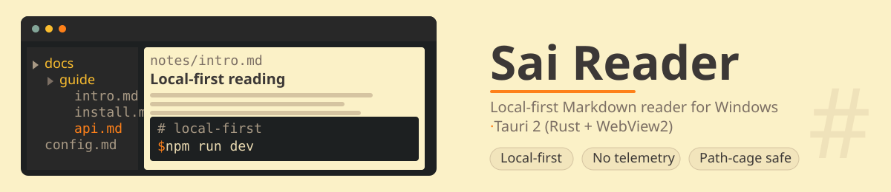
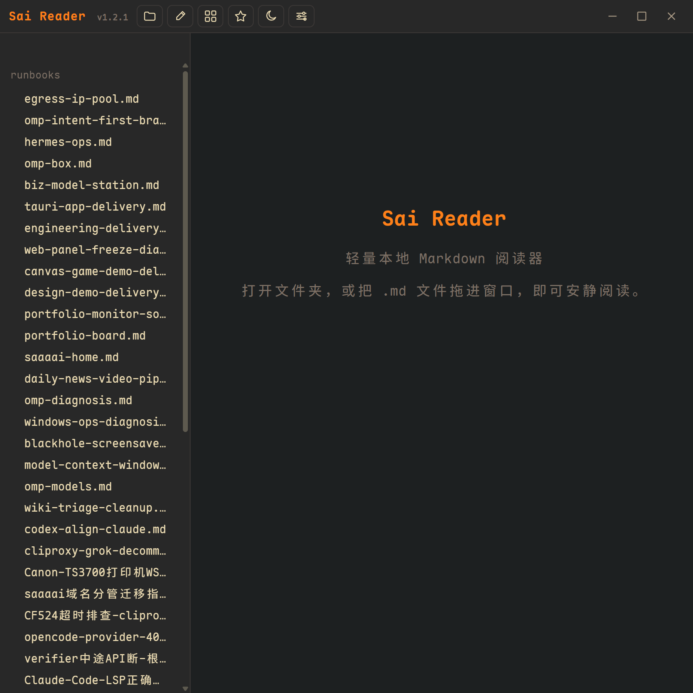

<div align="center">

**🌐 作者 [Sai](https://saaaai.com) · 个人主页 [saaaai.com](https://saaaai.com)** — AI 工作流与开源

**[English](README.md) · [简体中文](README.zh-CN.md) · [日本語](README.ja.md)**

</div>

# 透明MD（TMMD）



透明MD（TMMD）是一款面向 Windows 的透明本地优先 Markdown 阅读器，基于 Tauri 2（Rust + WebView2）构建。快速、私密、完全离线 —— 你的笔记永远不会离开你的设备。

## 功能特性

- **多根目录文库** — 将多个本地文件夹注册为文档根目录;通过侧边栏文件树(含目录大纲)浏览每个文库
- **本地优先 & 私密** — 纯文件系统访问,带路径围栏(path-cage);无云端、无遥测、无账号
- **完整的 Markdown 渲染** — 通过 [marked](https://github.com/markedjs/marked) 渲染 GitHub 风格 Markdown,[KaTeX](https://github.com/KaTeX/KaTeX) 渲染数学公式,[highlight.js](https://github.com/highlightjs/highlight.js) 代码高亮,外加零依赖**脚注**
- **阅读舒适** — 阅读地图(逐章地铁图)、大纲滚动同步、按文件记住进度、文内查找(Ctrl+F)、**库级全文搜索(按相关度排序 + 按文件分组)**、专注模式、无干扰模式,行宽 / 行高 / 正文字体可调
- **一个靠谱的编辑器** — 就地编辑、原子写入(保留 CRLF/BOM)、外部改动冲突检测(覆盖 / 取消)、外部变更实时监听、关窗守卫(保存 / 不保存 / 取消)、新建 · 另存为 · 重命名 · 删除到回收站、Tab 与多行缩进、Ctrl+H 查找替换、撤销栈按标签隔离、**打字机滚动**(光标钉在视口上三分之一处)
- **透明整窗** — 无边框亚克力 / Mica 玻璃,三档氛围 + 底色取色 + 可读性下限;系统关透明或高对比模式时自动回落为不透明
- **窗口与托盘的礼貌** — 几何按**物理像素分屏记忆**、在上次那块屏上打开、**任何子进程都不会闪控制台窗口**、托盘图标(显示 / 隐藏 / 退出,退出仍走未保存提醒)
- **导出** — 自包含 HTML(媒体内联成 `data:`),以及**直接导出 PDF**(无头 Chromium,零新增依赖;机器上没装 Chromium 时给可读提示而不是假装成功)
- **标签与历史** — 浏览器式标签 + 会话恢复、最近列表、按文件收藏
- **主题** — 浅色/深色切换,三套配色(charcoal / paper / gruvbox),**界面支持 中文 / English / 日本語**
- **自研更新器** — 程序内检查 → 下载 → SHA-256 强校验 → 静默安装(不引入第三方更新框架);清单地址与下载地址都锁在本仓 release 资产内
- **原生安装包** — 由 Tauri 生成的 NSIS + MSI 安装包

## 截图



上方 hero 已预览实际外观 —— 侧边栏文件树、纸质阅读页与代码块，均以应用自身的配色绘制。完整窗口截图将稍后补充。

## 环境要求

- Windows 10/11（WebView2 运行时，现代 Windows 默认已安装）
- [Rust](https://rustup.rs/)（stable 工具链）
- [Node.js](https://nodejs.org/) 18+

## 从源码构建

```powershell
npm install
npm run dev       # 带热重载的开发构建
npm run build     # 发布构建 → NSIS/MSI 安装包位于 src-tauri/target/release/bundle/
```

无需单独的前端构建步骤：前端位于 `ui-reader/`，直接内嵌。

## 架构

前端（`ui-reader/`）是纯 HTML/CSS/JS 单页应用。Rust 后端（`src-tauri/`）暴露了一个小而能力受限的 IPC 接口：

| 命令 | 说明 |
|---|---|
| `desktop_info` | 应用版本 / 平台信息 |
| `pick_folder` | 选择文库根目录文件夹 |
| `list_md_tree` | 列出根目录下的 `.md` 文件（按名称 + mtime 排序） |
| `read_text` | 读取文件（受路径围栏约束） |
| `load_roots` / `save_roots` | 持久化已注册的文库根目录（应用配置目录中的 `roots.json`） |
| `open_in_terminal` | 在已注册的根目录启动外部终端 |

### 安全模型

- **路径围栏（Path cage）**：每次文件读取都会规范化根目录，并拒绝任何逃逸出根目录的路径
- **最小权限**：IPC 权限在 `src-tauri/capabilities/default.json` 中声明；WebView 没有任何网络访问权限
- **不内嵌 shell**：终端以独立 OS 进程打开；WebView 永不持有 PTY

## 第三方声明

参见 [THIRD_PARTY_NOTICES.md](THIRD_PARTY_NOTICES.md) 了解打包进前端库的详情。

## 许可证

[MIT](LICENSE) © 2026 nakamotosai

## 状态与进度（进度主文件 · 2026-08-08 补节）

> 追踪规则：`skill://sai-long-project` + `skill://sai-closeout`；长流水见 `docs/CHANGELOG.md`；项目本卡 vps `~/project-portfolio/projects.md`。

- **状态**:活跃(v1.7.0 收官 2026-10-24 — 竞品差距分析路线图全部落地:排版/层级/动效换血、材质三选(直透/Acrylic/Mica)+系统回落、文内查找、库级全文搜索、脚注、代码块复制与行号、专注/无干扰、导出 HTML+打印、窗口几何记忆、界面语言 zh/en/ja)
- **依据**:`docs/2026-10-24-竞品与差距分析.md` · 变更记录:`docs/CHANGELOG.md`
- **残差**:1第一屏黑 2整窗玻璃 W0→W4(Mica 打底 + Acrylic 铬层) 3导出图片内联 4库搜索排序/正则 5自动更新
- **双仓**:GitHub(SSOT)+ Gitea(备份)双端同 HEAD(核 `git ls-remote`)

---

镜像：[GitHub](https://github.com/nakamotosai/TMMD) · Gitea（自托管）
